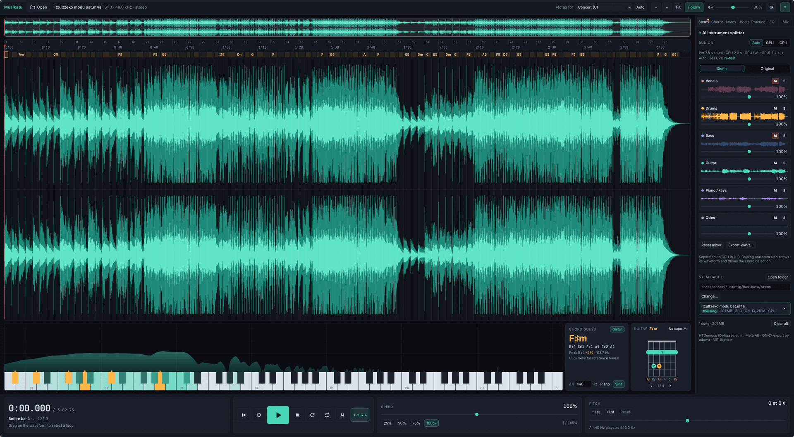

# Musikatu

A desktop workbench for transcribing music by ear: slow it down, loop it, see what's playing, and split it into instruments. Everything runs on your own computer.



## Features

- **Playback:** 5–200% speed without changing the pitch, ±12 semitones and cents of pitch shift, gapless loops, and a zoomable waveform.
- **AI instrument splitter:** vocals, drums, bass, guitar, piano and other, with mute, solo and volume for each, on CPU or GPU. The spectrum and chord guess listen to what you hear, or to stems you choose. Separated songs are cached: open one by clicking it in the stem cache list. If you move or rename a song, its stems and project are found again when you open it (checked by ear: the stems must add up to the song), or press **Locate…** next to it in the list.
- **Chords:**
  - live chord guess with guitar diagrams;
  - a whole-song chord chart you can edit;
  - export as text, bar by bar.
- **Beats and bars:** automatic tempo, bars and a metronome; loop bars N–M, snap selections to beats.
- **Guitar tabs:** open a Guitar Pro (.gp3/.gp4/.gp5/.gpx/.gp), MusicXML or alphaTex tab and it lines itself up with the recording: repeats are written out, intros or repeats the tab leaves out are skipped, and a capo or different tuning is found. For a song recorded to a click, bars follow the tab's tempo where the beat tracking slips. The tab scrolls with the playhead and shows the strings and frets sounding; click a bar to go there, Shift-click to loop bars, and drag a bar line (or **Bar line here**) to fix the sync. Poorly matched sections are marked. See `scripts/tab-eval/` for how well it lines up.
- **Audio → MIDI:** transcribe any instrument to a piano roll, play it along, and export MIDI that lines up with the bars. Transcribed notes also sharpen the chord chart and the live chord guess.
- **Practice:**
  - a count-in before playback;
  - a speed trainer that speeds the loop up as you repeat it.
- **Tools:**
  - EQ;
  - vocal cut;
  - spectrum on a reference piano;
  - instrument transposition;
  - markers and saved loops;
  - rebindable keys, global hotkeys and MIDI pedals.

## Layout

Every tool is a panel you can put where you like: in the **sidebar**, in the **bottom strip**, or in the **Tools window** (⚙ Tools in the top bar), a movable, resizable window with one tab per panel. Drag a tab, or the grip at the top of a bottom-strip panel, and drop it where you want it; a line shows where it will land. Drag the edge of the sidebar, the top of the bottom strip or the side of a bottom-strip panel to resize it, or a corner to resize both ways; the panel's contents grow with it (double-click an edge to reset). In the Tools window, **Show in main window** sends the open panel to the sidebar or the bottom strip. The layout is remembered, and **Reset layout** restores the defaults.

## Run

```sh
npm install
npm run dev                 # development
npm run install:linux       # build and install for this user (launcher + `musikatu` command)
npx electron-builder        # installers for this OS → release/
npm test
```

The stem separation model (136 MB) is downloaded from inside the app the first time it's used. The beat and note models are bundled.

## Models

| Task | Model | Licence |
|---|---|---|
| Instrument separation | [HTDemucs 6-stem](https://huggingface.co/adowu/htdemucs-6s-onnx) (Meta AI), ONNX | MIT |
| Beats and downbeats | [Beat This!](https://github.com/CPJKU/beat_this) small (JKU Linz), exported here, see `scripts/beat-model/` | MIT |
| Notes → MIDI | [Basic Pitch](https://github.com/spotify/basic-pitch) (Spotify) | Apache-2.0 |

Inference runs with ONNX Runtime in a background process.

Tab files are read with [alphaTab](https://github.com/CoderLine/alphaTab) (MPL-2.0), unmodified, loaded only when a tab is opened.

## Branches

- `ai-stems`: Musikatu (this version).
- `main`: the classic version without AI, tag `v1-classic`.
